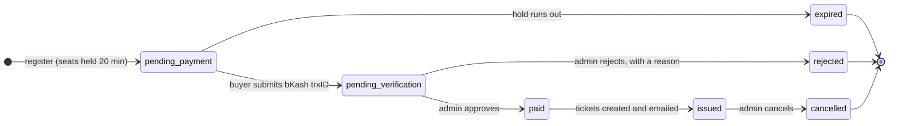
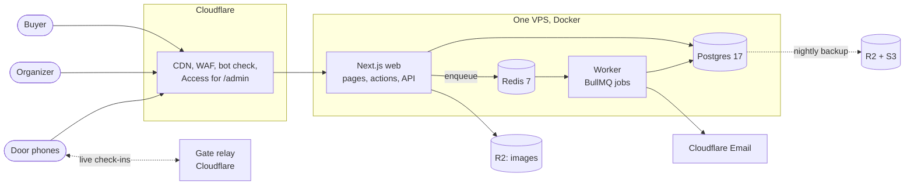

<div align="center">

<picture>
  <source media="(prefers-color-scheme: dark)" srcset=".github/assets/logo-dark.svg">
  
</picture>

### Ticketing for live events in Dhaka, paid by bKash and checked in by phone.

[](https://github.com/Ashfak-Hossain/EchoAndAura/actions/workflows/ci.yml)
[](https://github.com/Ashfak-Hossain/EchoAndAura/actions/workflows/deploy.yml)
[](https://uptime.betterstack.com/?utm_source=status_badge)
[](https://github.com/Ashfak-Hossain/EchoAndAura/releases)
[](LICENSE)

**[echoandaura.com](https://echoandaura.com)** · [Changelog](CHANGELOG.md) · [Security](SECURITY.md)

</div>

---

## About

**Echo & Aura** is a live-events organizer in Dhaka. This repository is
its ticketing platform: the public site where people find an event and buy
tickets, the admin where the organizer runs the sale, and the scanner the
door staff use on event night.

In Bangladesh, most people pay with **bKash**, by sending money from their
phone. There is no bKash API here on purpose: a buyer sends the money,
pastes the transaction ID, and a person checks it against the bKash
statement before any ticket exists. Everything else, from holding seats to
emailing tickets to admitting a guest, is automated around that one human
decision.

## Table of contents

- [Highlights](#highlights)
- [How it works](#how-it-works)
- [Architecture](#architecture)
- [Engineering principles](#engineering-principles)
- [Tech stack](#tech-stack)
- [Getting started](#getting-started)
- [Common commands](#common-commands)
- [Project structure](#project-structure)
- [Testing](#testing)
- [Deployment and operations](#deployment-and-operations)
- [Documentation](#documentation)
- [Versioning](#versioning)
- [Contributing](#contributing)
- [Security](#security)
- [License](#license)

## Highlights

| For buyers                                                     | For the organizer                                                       | At the door                                                     |
| -------------------------------------------------------------- | ----------------------------------------------------------------------- | --------------------------------------------------------------- |
| Register in under a minute, on a phone, on a slow connection   | A verification queue: check the trxID and amount, approve or reject     | Scan ticket QR codes with any phone, opened by a gate pass      |
| Seats held for 20 minutes on a visible countdown while you pay | Approving issues and emails the tickets, with no extra step             | Admits in under half a second, and keeps working with no signal |
| Tickets by email, with a PDF and a web ticket page             | Orders search, CSV export, sales reports and an audit trail per order   | Gates share check-ins live; a copied QR shows where it was used |
| Pass a ticket on: rename it until registration closes          | Ticket types, Early Bird windows, promo codes and complimentary tickets | A pre-doors test per phone, and a printed list as a last resort |

## How it works

Every order moves through one state machine. Transitions are validated in
code, an invalid one throws, and each one writes an audit row.



1. **Register.** The buyer picks one ticket type and a quantity (up to 10).
   The server prices the order from the database, never from the browser,
   and holds the seats with one atomic update.
2. **Pay.** The buyer sends the amount by bKash and pastes the transaction
   ID and the sending number. The database refuses a trxID it has seen
   before.
3. **Verify.** The organizer checks the trxID and amount against the bKash
   statement. Approve or reject. Expired and rejected orders release their
   seats.
4. **Deliver.** Approving issues the tickets in one transaction. The email,
   with its PDF, is queued and sent after the commit.
5. **Admit.** At the gate, a phone scans the QR. One atomic check-in means
   a ticket gets in once, even when two gates scan it at the same moment.

## Architecture



- **One codebase, two processes.** All business logic lives in
  `src/server/` and never imports Next.js, so the web app and the worker
  call the same services.
- **Thin edges.** A route handler or server action parses its input with
  Zod, calls a service and maps the result. Services call repositories,
  and only repositories touch the database.
- **Network work is queued.** Email, PDFs and exports run in the worker,
  after the database commit, never inside a transaction.

The longer picture, with the data model and sequence diagrams, is in
[docs/ARCHITECTURE.md](docs/ARCHITECTURE.md) and
[docs/DIAGRAMS.md](docs/DIAGRAMS.md).

## Engineering principles

The rules that protect money and seats are invariants, enforced by the
database where it can and by tests everywhere else. The full text is in
[CLAUDE.md](CLAUDE.md).

| #   | Invariant                                                           | Why                                                                     |
| --- | ------------------------------------------------------------------- | ----------------------------------------------------------------------- |
| 1   | Money is integer paisa (`BIGINT`), converted in one module          | Floats lose paisa; one module means one place to get it right           |
| 2   | Inventory changes with one conditional atomic `UPDATE`              | Read-then-write oversells under load; a `CHECK` constraint backstops it |
| 3   | A bKash trxID is unique in the database, stored normalised          | The same payment can never pay for two orders                           |
| 4   | Only `fulfilment.service.ts` marks an order paid and issues tickets | One path to money-in means one path to audit                            |
| 5   | Prices never come from the client                                   | The request carries ticket type IDs and quantities only                 |
| 6   | Every order state change writes an append-only audit row            | "Why was this order rejected?" is answered by the database              |
| 7   | No network calls inside a database transaction                      | A slow email provider must never hold a lock on seats                   |

Every non-obvious choice is recorded as an Architecture Decision Record in
[docs/decisions/](docs/decisions/README.md), indexed by area.

## Tech stack

| Layer          | Choice                                                                          |
| -------------- | ------------------------------------------------------------------------------- |
| App            | Next.js 16 (App Router), React 19, TypeScript (strict), Node 26                 |
| Data           | Postgres 17 with Drizzle ORM; Redis 7 with BullMQ for the worker's jobs         |
| UI             | Tailwind CSS 4, shadcn/ui, React Email, React PDF                               |
| Auth           | better-auth: admin password with an authenticator app; buyer email-link sign-in |
| Edge and email | Cloudflare (DNS, CDN, WAF, Turnstile, Access, R2, Email Service)                |
| Infrastructure | Docker, Dokploy, GitHub Actions, Terraform, Ansible                             |
| Observability  | Better Stack uptime, Sentry (errors only, privacy allowlist), pino logs         |
| Testing        | Vitest (unit and integration against real Postgres and Redis), Playwright       |

## Getting started

**Prerequisites:** Node 26, pnpm 11 and Docker.

```bash
pnpm install
cp .env.example .env            # then fill in the values (docs/ENVIRONMENT.md)
docker compose up -d            # Postgres, Redis and MinIO (a local R2)
pnpm db:migrate
pnpm admin:create               # your admin login
pnpm db:seed                    # demo events and orders
pnpm dev                        # http://localhost:3000
pnpm worker                     # in a second terminal: emails and hold expiry
```

Or open it in the dev container (VS Code or Codespaces): it brings Node,
pnpm and the services, and runs the install and migration for you
([docs/DEVELOPMENT.md → Dev container](docs/DEVELOPMENT.md#dev-container)).

The first admin sign-in asks you to set up an authenticator app. Lost it
locally? `pnpm admin:reset-2fa <email>` clears it. The full guide is
[docs/DEVELOPMENT.md](docs/DEVELOPMENT.md).

## Common commands

| Command                 | What it does                                                    |
| ----------------------- | --------------------------------------------------------------- |
| `pnpm dev`              | The app with hot reload                                         |
| `pnpm worker`           | The background worker (emails, hold expiry, gate relay)         |
| `pnpm verify`           | The full gate: typecheck, lint, unit tests and production build |
| `pnpm test`             | Unit tests                                                      |
| `pnpm test:integration` | Integration tests against the local Postgres and Redis          |
| `pnpm test:e2e`         | Playwright end-to-end tests                                     |
| `pnpm db:generate`      | A migration from a schema change (never hand-edit `drizzle/`)   |
| `pnpm db:studio`        | Browse the local database                                       |

## Project structure

```text
src/
  app/            Next.js routes: (measured) and (public) site, admin, door scanner, api
  server/         business logic, no Next.js imports
    services/       orders, fulfilment, inventory, door, reports, ...
    repositories/   the only code that queries the database
    email/ pdf/     templates, rendered by the worker
    queue/          BullMQ queues and jobs
  db/             Drizzle schema
  worker.ts       the worker's entry point
  components/     UI (components/ui is generated by shadcn)
drizzle/          generated SQL migrations
relay/            the gate relay (a Cloudflare Worker)
tests/            unit, integration and e2e
ops/              Terraform, Ansible, database roles, load tests
docs/             architecture, ADRs, runbook, infrastructure records
```

## Testing

```bash
pnpm verify                     # what every pull request must pass
pnpm test:integration           # needs docker compose up
```

- **Unit tests** cover every service, and every money and state-machine
  function on its failure path as well as its happy path.
- **Integration tests** run against a real Postgres and Redis.
  [`tests/integration/inventory.concurrency.test.ts`](tests/integration/inventory.concurrency.test.ts)
  is the most important test in the repository: many buyers race for the
  last seats, and it proves none are oversold. It is never skipped.
- **End-to-end tests** drive a production build with Playwright, from
  registration to the door.

CI runs all of it on every pull request and every push to `main`.

## Deployment and operations

Production is one VPS running Dokploy behind Cloudflare. CI builds the web
and worker images, scans them for critical vulnerabilities, and every merge
to `main` deploys and then confirms the running revision. Database backups
run nightly to R2 with an off-site copy in S3. Cloudflare and AWS are
managed with Terraform, and the server with Ansible.

[docs/DEPLOY.md](docs/DEPLOY.md) covers deploys and rollbacks, and
[docs/RUNBOOK.md](docs/RUNBOOK.md) covers incidents and the event-night
checklist.

## Documentation

| Read                                         | For                                                  |
| -------------------------------------------- | ---------------------------------------------------- |
| [docs/README.md](docs/README.md)             | The index of every document                          |
| [docs/ARCHITECTURE.md](docs/ARCHITECTURE.md) | How the system fits together                         |
| [docs/decisions/](docs/decisions/README.md)  | Why it is built this way (ADRs)                      |
| [docs/DEVELOPMENT.md](docs/DEVELOPMENT.md)   | Local setup, conventions, dependencies and releases  |
| [docs/RUNBOOK.md](docs/RUNBOOK.md)           | What to do when something breaks, and on event night |
| [CHANGELOG.md](CHANGELOG.md)                 | What each release changed                            |

## Versioning

Releases follow [Semantic Versioning](https://semver.org/). Every merge to
`main` deploys; a version tag marks a milestone and names the images it
shipped, so a rollback can pin one. Release notes open with the version's
[CHANGELOG.md](CHANGELOG.md) section. How to cut one:
[docs/DEVELOPMENT.md → Releases](docs/DEVELOPMENT.md#releases).

## Contributing

Bug reports and ideas are welcome as issues; pull requests from outside the
maintainers are not accepted. [CONTRIBUTING.md](CONTRIBUTING.md) says why,
and how every change here is made.

## Security

Please report vulnerabilities privately, never in a public issue.
[SECURITY.md](SECURITY.md) says how.

## License

Copyright © 2026 Raj Sr, trading as Echo & Aura. All rights reserved.

This source code is public to read, not to reuse. See [LICENSE](LICENSE).
